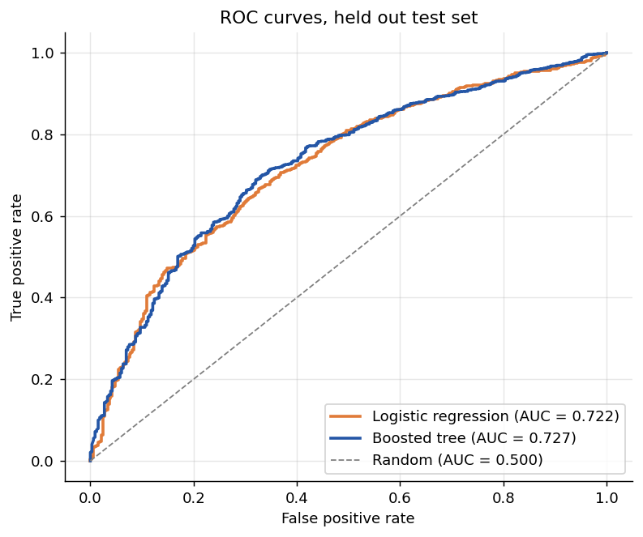
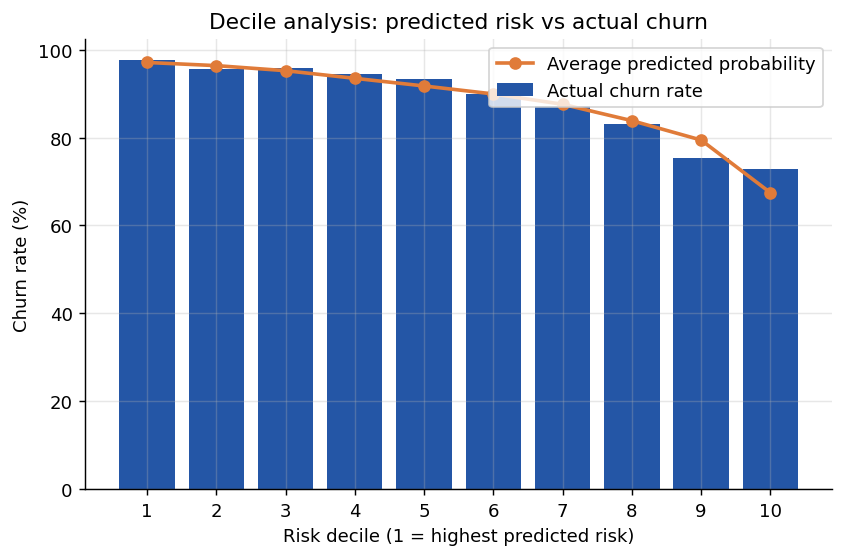
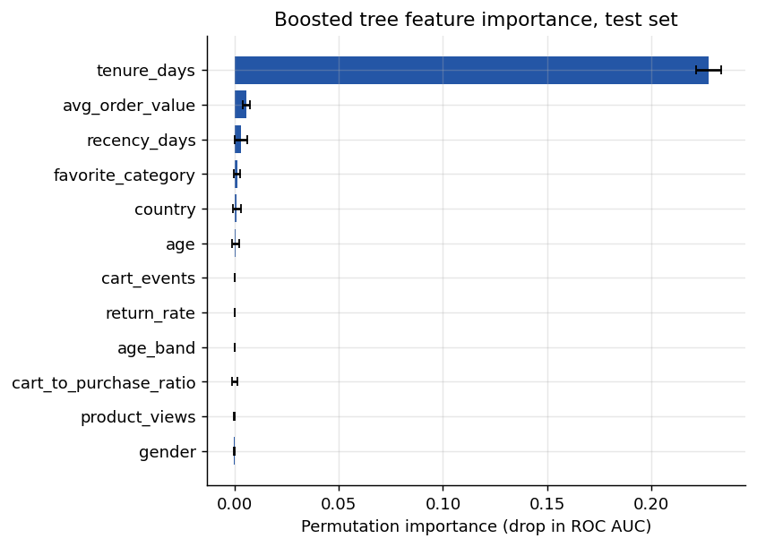
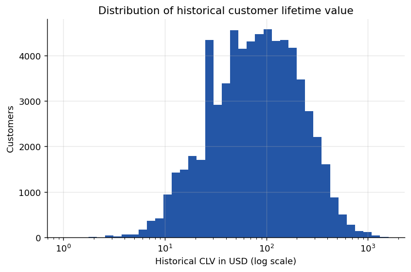
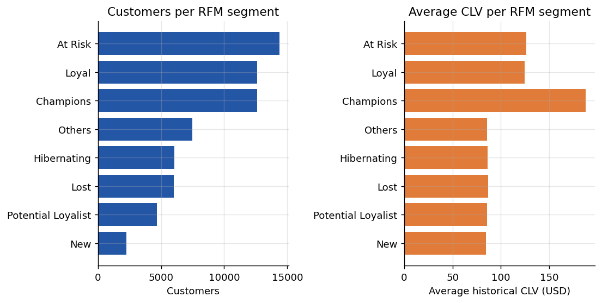
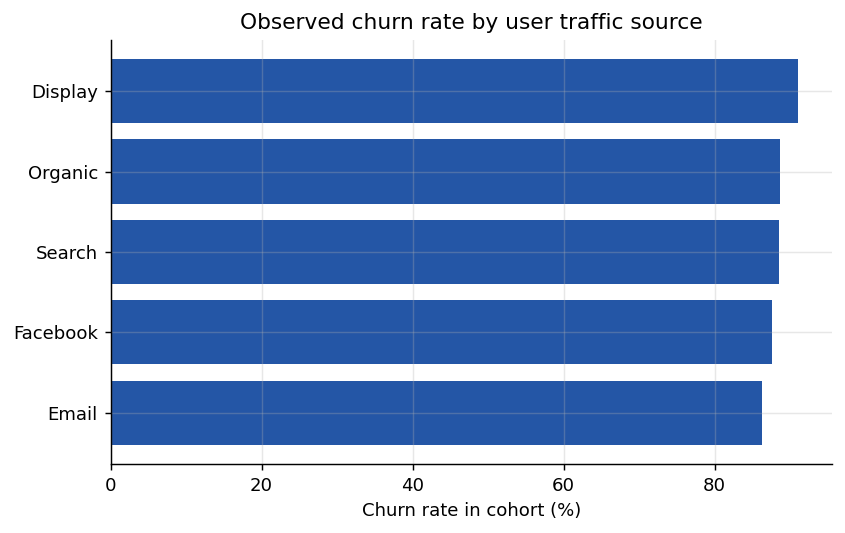
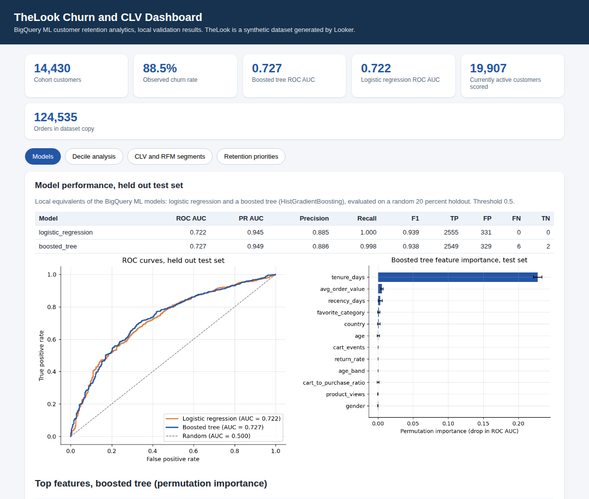
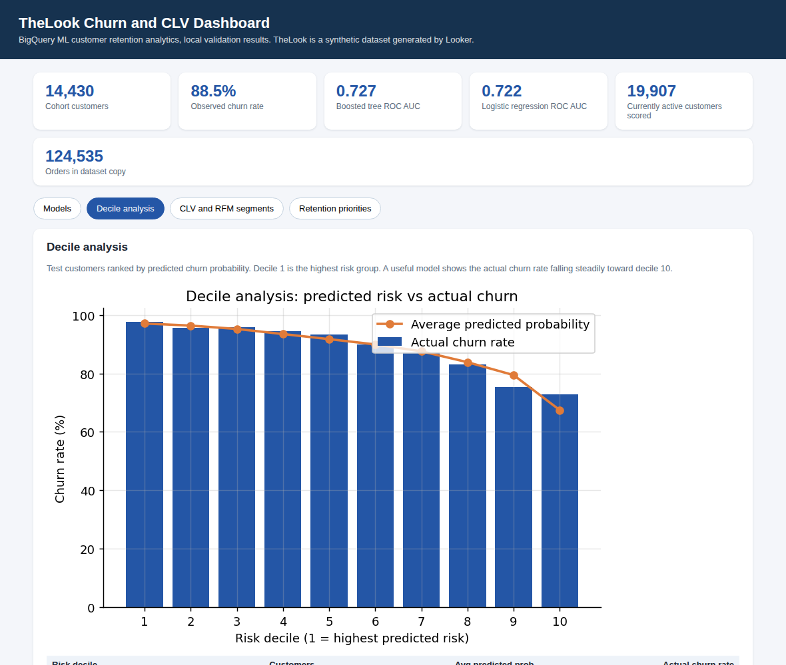
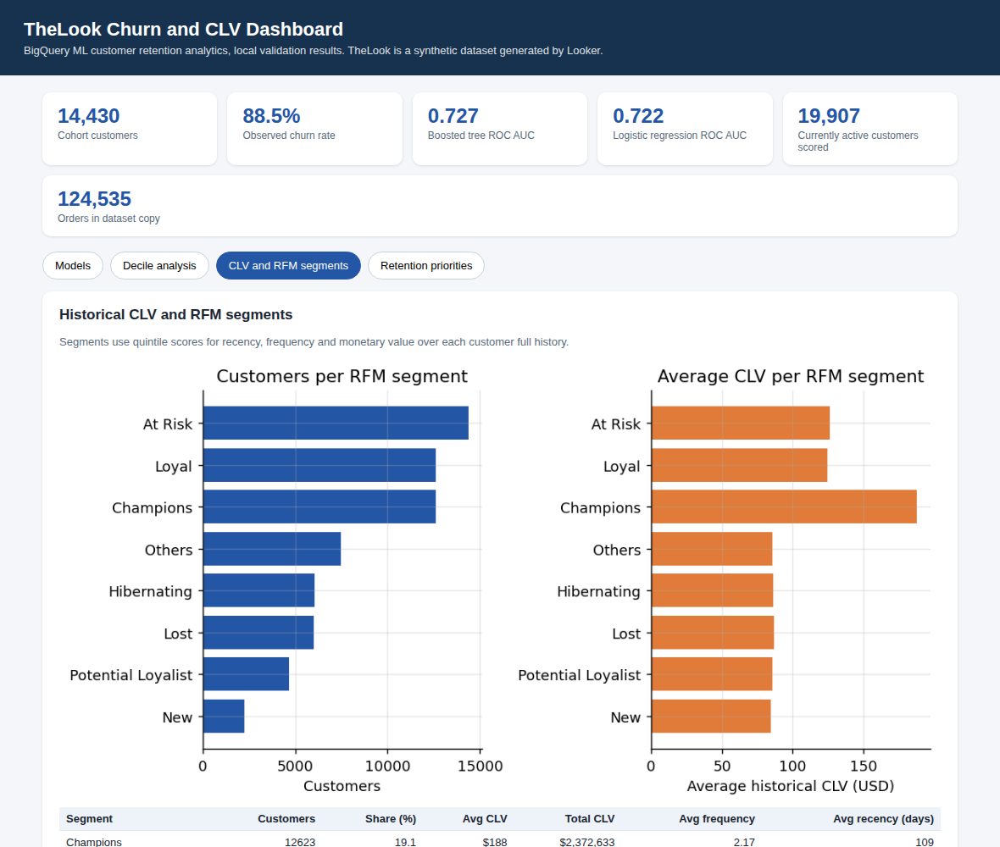

# TheLook Churn and CLV: BigQuery ML Customer Retention Analytics

A customer retention analytics project on the TheLook eCommerce dataset. It defines churn explicitly for a non-subscription store, engineers behavioural features in SQL, trains two BigQuery ML churn models (logistic regression and a boosted tree), validates them with a decile analysis, and combines churn scores with historical customer lifetime value (CLV) and RFM segments to produce a retention priority list.

**Read this first, in the interest of honesty.** TheLook is a **synthetic dataset** created by Looker. The SQL in this repository is genuine BigQuery ML written against the real `bigquery-public-data.thelook_ecommerce` schema, but it was **not executed on BigQuery** from the environment where this project was built, because that environment has no Google Cloud credentials. The numbers below were computed locally with the scikit-learn equivalents of the two model types, on a local copy of the same dataset produced with Google's official generator (details in the Dataset section). No BigQuery job statistics are claimed anywhere in this project.

## Problem framing and churn definition

E-commerce has no subscriptions to cancel, so churn has to be defined from behaviour. This project uses the following definition everywhere (SQL, Python, dashboard, tests):

| Element | Definition |
| --- | --- |
| Anchor date | The maximum order date in the data: 2026-11-23 |
| Cutoff | 90 days before the anchor: 2026-08-25 |
| Observation window | The 6 months before the cutoff: 2026-02-25 to 2026-08-25 |
| Label window | The 90 days from the cutoff: 2026-08-25 to 2026-11-23 |
| Cohort | Customers with at least one valid order in the observation window |
| Valid order | An order whose status is not Cancelled and not Returned |
| Churn label | 1 if the customer placed no valid order in the label window, else 0 |

Features come only from the observation window, so nothing from the label window leaks into the model. The resulting cohort has **14,430 customers**, of whom **12,775 churned** and **1,655 bought again**, an observed churn rate of **88.5 percent**. That rate is high because most TheLook customers order rarely (the median customer in the full history has a single order), so a 90 day repurchase window is demanding. It also means the useful question is not "will this customer churn, yes or no" but "who is most at risk", which is why the decile analysis matters more than the raw accuracy.

## Dataset

TheLook is the fictitious fashion eCommerce store created by the Looker team and published as the BigQuery public dataset `bigquery-public-data.thelook_ecommerce`.

The local copy used for the numbers in this project was generated with the **official generator** that produces the BigQuery dataset, published by Google in the `GoogleCloudPlatform/public-datasets-pipelines` repository, run with the production parameters from that repository's own pipeline definition (`NUM_OF_USERS=100000`, `NUM_OF_GHOST_EVENTS=5`) and a fixed random seed (42) for reproducibility. The static seed tables (products, distribution centers, world population) are the exact files from that repository. A generated copy is a different random draw from the same generator, so it is statistically equivalent to the live BigQuery tables but not byte-identical to them. Public CSV mirrors of the live tables were searched for first; the ones found were either independently sampled per table (join coverage between tables as low as 39 percent) or partial, so the generator route was the only faithful option. As a cross-check, a genuine BigQuery export of the order_items table found in a public mirror (a June 2022 snapshot) holds 180,952 rows over 124,923 orders, very close to this copy's 180,244 rows over 124,535 orders.

Actual counts of the copy used here:

| Table | Rows |
| --- | --- |
| users | 100,000 |
| orders | 124,535 |
| order_items | 180,244 |
| events | 2,416,147 |
| products | 29,120 |
| inventory_items | 486,819 |
| distribution_centers | 9 |

Orders span 2019-01-06 to 2026-11-23. Of the 100,000 users, 66,064 have at least one valid order in the full history.

## Run it free in the BigQuery sandbox

1. Open [console.cloud.google.com/bigquery](https://console.cloud.google.com/bigquery) and sign in with any Google account. The sandbox needs no billing account and no credit card.
2. Create a project (or use an existing one). Queries against public datasets count toward the free tier of 1 TB of query processing per month, which is far more than this project needs.
3. Pin the public dataset: in the Explorer panel choose "Add data", "Pin a project", and enter `bigquery-public-data`. Expand it and confirm `thelook_ecommerce` is listed.
4. Run the files in `sql/` in order, from `01_feature_engineering.sql` to `07_clv_and_rfm_segmentation.sql`. They create a dataset called `thelook_ml` in your project with the feature view, the two models, the prediction tables, and the CLV and RFM table.
5. Compare your `ML.EVALUATE` output and decile table with the local results below. Small differences are expected: the live BigQuery tables are a different draw from the generator and keep growing, and BigQuery ML has its own training implementation.

## Reproduce the local results

Note on the packaged archive: to keep the download size reasonable, the distributed ZIP omits the two largest raw tables (`data/raw_mirror/events.csv`, about 427 MB, and `data/raw_mirror/inventory_items.csv`, about 100 MB). Step 1 below recreates them, along with every other table, in about 15 minutes.

```bash
# 1. Generate the local copy of the dataset (needs the faker package).
#    Downloads of the seed files are already in data/raw_mirror/seeds/.
python3 -m venv .venv && .venv/bin/pip install faker numpy
.venv/bin/python analysis/generate_thelook_copy.py

# 2. Build features, train both models, write all result tables.
python3 analysis/run_analysis.py

# 3. Charts, dashboard, screenshots, tests.
python3 analysis/make_charts.py
python3 analysis/build_dashboard.py
python3 analysis/screenshot_dashboard.py
python3 -m pytest tests/ -q
```

## Key findings

### Model performance (held out test set, 2,886 customers)

| Model | ROC AUC | PR AUC | Precision | Recall | F1 | TP | FP | FN | TN |
| --- | --- | --- | --- | --- | --- | --- | --- | --- | --- |
| Logistic regression | 0.722 | 0.945 | 0.885 | 1.000 | 0.939 | 2,555 | 331 | 0 | 0 |
| Boosted tree | 0.727 | 0.949 | 0.886 | 0.998 | 0.938 | 2,549 | 329 | 6 | 2 |

Two honest readings of this table:

* The ranking signal is real but moderate. ROC AUC of 0.72 to 0.73 is well above the 0.50 of a random ranker, and the boosted tree is slightly ahead of logistic regression, as expected.
* At the default 0.5 threshold both models predict almost everyone as churned, which is why recall is near 1.0 and true negatives are near zero. With an 88.5 percent base churn rate, the threshold metrics flatter the models (a random ranker already scores a PR AUC of 0.885 here, equal to the churn rate). The scores should be used as a ranking, not as a yes or no classifier. The decile analysis below is the meaningful evaluation.

### Decile analysis (boosted tree, test set)

| Risk decile | Avg predicted probability | Actual churn rate |
| --- | --- | --- |
| 1 (highest risk) | 97.1% | 97.6% |
| 2 | 96.4% | 95.5% |
| 3 | 95.2% | 95.8% |
| 4 | 93.5% | 94.5% |
| 5 | 91.7% | 93.4% |
| 6 | 89.9% | 90.0% |
| 7 | 87.6% | 87.2% |
| 8 | 83.8% | 83.0% |
| 9 | 79.4% | 75.3% |
| 10 (lowest risk) | 67.5% | 72.9% |

The actual churn rate falls steadily from 97.6 percent in the highest risk decile to 72.9 percent in the lowest, and the predicted probabilities track the actual rates closely. The model separates the extremes by about 25 percentage points. The separation is useful for prioritising retention effort, and it is also modest, which is the truth about this data: order timing in the generator is largely random, so there is a hard ceiling on how predictable churn can be.

### What drives the score

Permutation importance on the test set (drop in ROC AUC when a feature is shuffled) gives one dominant feature and a long tail of near-zero ones:

| Feature | Importance |
| --- | --- |
| tenure_days | 0.2275 |
| avg_order_value | 0.0056 |
| recency_days | 0.0029 |
| favorite_category | 0.0012 |
| country | 0.0010 |
| age | 0.0005 |
| all other features | 0.0000 or slightly negative |

Tenure (days between signup and the cutoff) carries almost all of the signal. This is a property of the synthetic generation process: each generated customer receives a fixed lifetime pattern of orders placed over a span after signup, so a customer who joined long ago and is still ordering inside the observation window is disproportionately likely to be near the end of that pattern. Event features (sessions, product views, cart activity) and RFM staples such as frequency add almost nothing once tenure is known. On real store data the ranking of features would look different; the pipeline, not this specific ranking, is the reusable part.

### CLV and RFM segments (full history, 66,064 customers with a valid order)

Historical CLV (total valid spend per customer) averages **USD 121.70** with a median of **USD 79.95**, a 90th percentile of **USD 273.47**, a 99th percentile of **USD 598.39**, and a maximum of **USD 1,596.49**. Total historical CLV is **USD 8,040,114**.

| Segment | Customers | Share | Avg CLV | Total CLV |
| --- | --- | --- | --- | --- |
| Champions | 12,623 | 19.1% | USD 187.96 | USD 2,372,633 |
| At Risk | 14,390 | 21.8% | USD 126.36 | USD 1,818,339 |
| Loyal | 12,625 | 19.1% | USD 124.80 | USD 1,575,603 |
| Others | 7,499 | 11.4% | USD 85.67 | USD 642,404 |
| Lost | 6,002 | 9.1% | USD 86.85 | USD 521,257 |
| Hibernating | 6,033 | 9.1% | USD 86.33 | USD 520,814 |
| Potential Loyalist | 4,652 | 7.0% | USD 85.83 | USD 399,288 |
| New | 2,240 | 3.4% | USD 84.72 | USD 189,776 |

Champions are 19.1 percent of buyers and hold 29.5 percent of total CLV. The At Risk segment is the single largest pool of money to defend after Champions, with USD 1.82 million of historical value in customers whose recent behaviour has gone quiet.

### Retention priority list

Scoring the 19,907 currently active customers (observation window ending at the anchor date) and ranking by expected value at risk (churn probability times historical CLV) puts high-value Champions at the top even though their segment is the healthiest, because their CLV is large and the base churn probability is high for everyone. The top entry is user 41812, a Champion with 4 lifetime orders, a historical CLV of USD 1,533.86, a churn probability of 0.962, and USD 1,474.83 of expected value at risk. The full top 100 is in `data/results/retention_priority_sample.csv` and the top 50 is browsable in the dashboard.

### Churn by traffic source

Observed cohort churn rates by the traffic source recorded on the user profile: Display 91.0 percent (578 customers), Organic 88.7 percent, Search 88.6 percent, Facebook 87.6 percent, Email 86.3 percent (713 customers). The spread across sources is small, consistent with traffic source carrying little importance in the model.

## Charts













## Dashboard

Open `dashboard/index.html` in a browser. It is a single self-contained file with KPI cards, tabbed sections for model performance, the decile analysis, CLV and RFM segments, and a filterable retention priority table.







## Methods

* **Features (20).** Recency (days since last valid order), frequency, monetary value, total items, average order value, average basket size, return rate, sessions, total events, product views, cart events, purchase events, cart-to-purchase ratio, tenure days, age, age band, gender, traffic source, country, and favorite product category. Anonymous events (null user id, the generator's ghost sessions) are excluded from event features.
* **Models.** The BigQuery ML files train `LOGISTIC_REG` and `BOOSTED_TREE_CLASSIFIER`. The local validation trains their scikit-learn equivalents, `LogisticRegression` and `HistGradientBoostingClassifier`, with matching hyperparameters where the libraries allow it (100 iterations, learning rate 0.1, depth 6, L2 regularization 1.0 for the tree).
* **Split.** Random 80/20 train and test split with stratification on the label locally; the BigQuery ML files use `data_split_method = 'RANDOM'` with an evaluation fraction of 0.2.
* **Importance.** BigQuery ML reports gain-based importance through `ML.WEIGHTS`. The local run reports permutation importance on the test set (drop in ROC AUC, 5 repeats). The two measures are related but not identical.
* **RFM quintiles.** Scores use positional quintiles (the NTILE approach in the SQL). Frequency is heavily tied (most customers have one or two orders), so tied customers are split across adjacent quintiles positionally, in both the SQL and the Python versions. Segment boundaries should be read as approximate for that reason.
* **Value at risk.** Churn probability multiplied by historical CLV is a ranking heuristic, not a revenue forecast.

## Limitations

* **Synthetic data.** TheLook is generated, not observed. Order timing in the generator is largely random, which caps churn predictability and produces the tenure-dominated importance ranking. Treat every finding as a demonstration of method, not as evidence about real shoppers.
* **SQL not executed on BigQuery here.** The BigQuery ML files were written and reviewed against the public dataset schema, but this environment has no Google Cloud credentials, so the models were not trained on BigQuery itself. All reported metrics come from the local scikit-learn run on the generated copy described above. Running the SQL in the free sandbox is the intended way to reproduce the pipeline end to end on BigQuery.
* **Generated copy, not a live export.** The local copy is a different random draw from the same official generator (seed 42, production parameters). Counts and metrics will differ slightly from the live BigQuery tables and from any other draw.
* **Threshold metrics are weak evidence here.** With an 88.5 percent churn base rate, accuracy-style metrics at a 0.5 threshold are close to meaningless; the ROC AUC and the decile table are the honest evaluations.
* **Generator adaptations.** The local generation driver replaces the GCS upload with local file writes, fixes random seeds, streams CSV output, and swaps one address lookup helper for a cached equivalent with identical outputs and identical random stream consumption (verified on a small A/B run). The generation logic itself is the unmodified upstream code, kept in `analysis/thelook_generator_upstream.py`.

## File structure

```text
thelook-churn-clv-bigquery-ml/
  README.md
  LICENSE
  sql/
    01_feature_engineering.sql        Labeled feature view and churn definition
    02_train_logistic_regression.sql  BigQuery ML baseline model
    03_train_boosted_tree.sql         BigQuery ML main model
    04_evaluation.sql                 ML.EVALUATE, confusion matrix, ROC curve
    05_feature_importance.sql         ML.WEIGHTS for both models
    06_prediction_and_deciles.sql     Decile analysis and current customer scores
    07_clv_and_rfm_segmentation.sql   CLV, RFM segments, retention priorities
  analysis/
    generate_thelook_copy.py          Local driver for the official generator
    thelook_generator_upstream.py     Unmodified upstream generator (Google)
    run_analysis.py                   Local feature, training and results pipeline
    make_charts.py                    All charts from the result tables
    build_dashboard.py                Self-contained HTML dashboard builder
    screenshot_dashboard.py           Playwright screenshots for this README
  data/
    raw_mirror/                       Generated copy of the TheLook tables
      seeds/                          Official static inputs (products, world pop)
    results/                          Deliverable result tables (CSV and JSON)
    processed/                        Feature and prediction tables
  charts/                             PNG charts used above
  dashboard/                          index.html plus README screenshots
  tests/
    test_results.py                   Consistency tests for the result tables
```

## License

MIT. The upstream generator file `analysis/thelook_generator_upstream.py` is from the GoogleCloudPlatform/public-datasets-pipelines repository and remains under its own Apache 2.0 license; it is included so the data copy in this project is fully reproducible.
